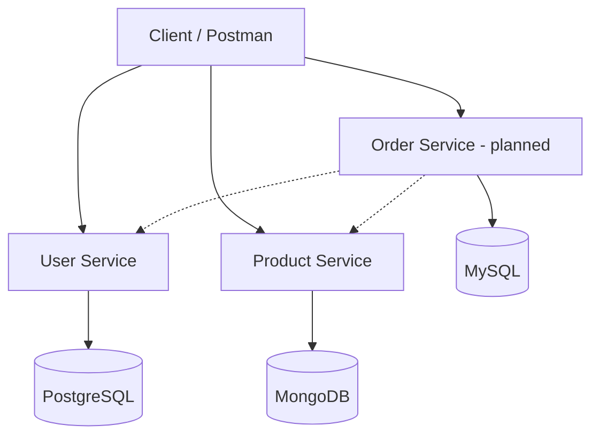

# ShopLite – Microservices Project

ShopLite is a simple online shopping system built using a microservices architecture.
Users can register, browse products, and place orders.

## Architecture

## Services

| Service | Responsibility | Database |
|---|---|---|
| User Service | Registration, login, profiles | PostgreSQL |
| Product Service | Product catalog | MongoDB |
| Order Service (planned) | Places orders, checks user and product | MySQL |

## Planned APIs

**User Service**
- `POST /users/register`
- `POST /users/login`
- `GET /users/{id}`

**Product Service**
- `GET /products`
- `POST /products`
- `GET /products/{id}`

**Order Service (planned)**
- `POST /orders`

## Tech Stack

- Python Flask (REST APIs)
- Docker and Docker Compose
- Kubernetes (Minikube)
- GitHub Actions (CI/CD)
- Prometheus and Grafana (monitoring)
- Postman (API testing)

## Team and Work Division

| Member | Responsibility |
|---|---|
| Iatidel | User Service, PostgreSQL, Dockerfile |
| Ruchi | Product Service, MongoDB, Dockerfile |
| Sukrutha | Docker Compose, GitHub repo, Kubernetes YAML files |

## Project Plan

- [x] Project design and GitHub repository setup
- [ ] Build User and Product services with Docker Compose
- [ ] Deploy to Kubernetes (Minikube)
- [ ] HPA, RBAC and Network Policies
- [ ] Testing, CI/CD pipeline, monitoring
- [ ] Final presentation
